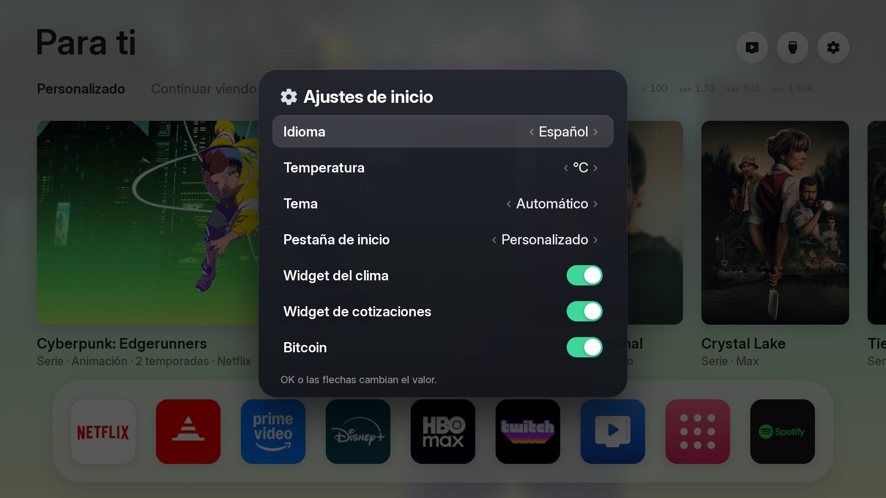
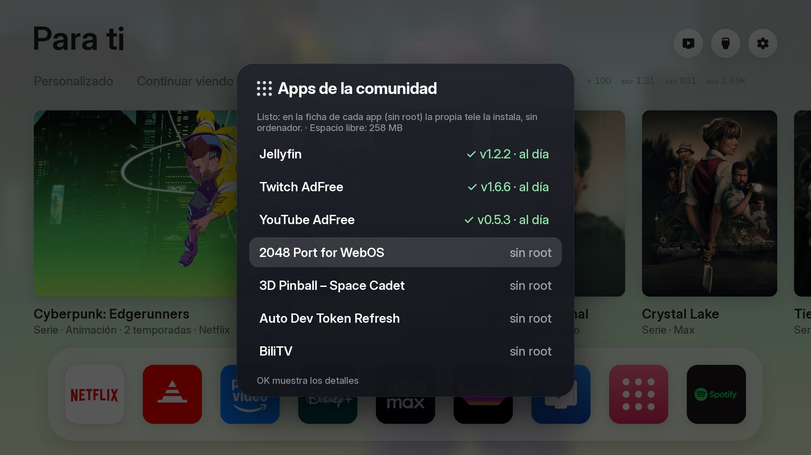
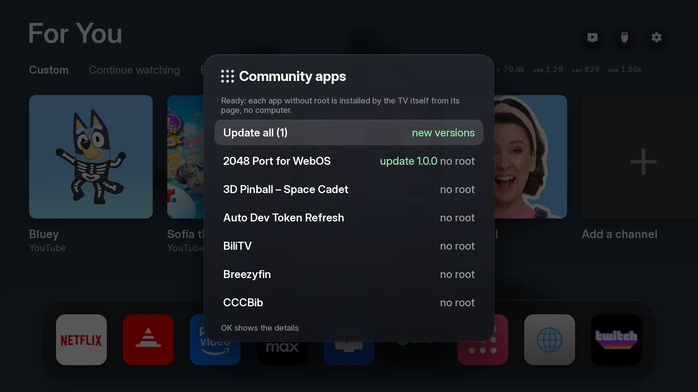
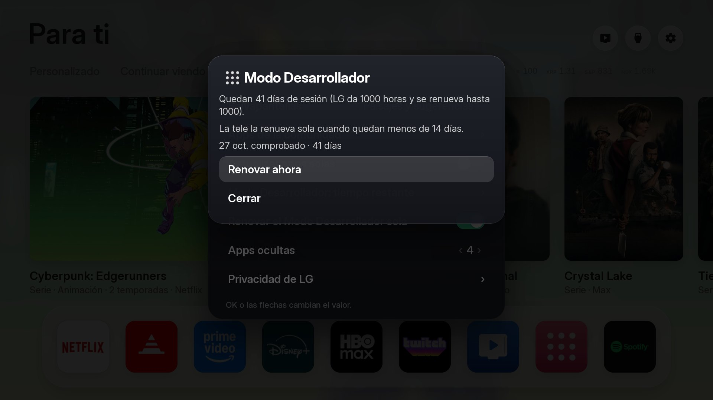
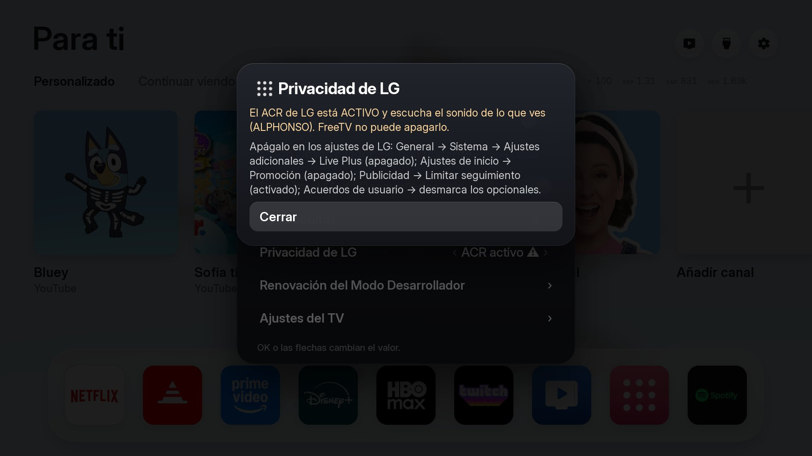
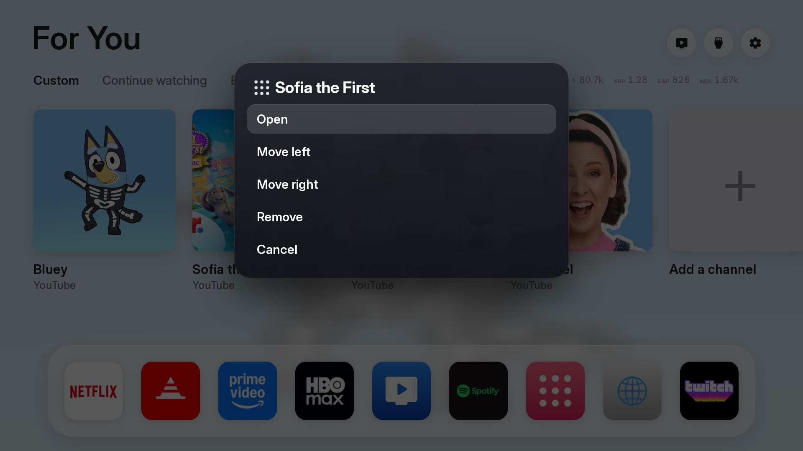

# FreeTV

**A clean, ad-free home screen for your TV, and a Home button that always takes you to it.**

**LG (webOS): tested** · Samsung (Tizen 2017+): experimental · Android TV and Google TV: Free My TV's app included · [what there is for each TV](docs/OTRAS-TELES.md)

[Versión en español ↓](#freetv-en-español) · [Guide to do it with any AI](docs/GUIA-IA.md) · [Troubleshooting](docs/PROBLEMAS.md)
(the guides are in Spanish for now; any AI can translate them for you)


<table><tr><td width="33%"><br><sub>Home Settings: language, theme, start tab…</sub></td><td width="33%"><br><sub>The Store lists what you have installed, with its version</sub></td><td width="33%"><br><sub>Apps with a new version are marked; Update all</sub></td></tr><tr><td width="33%"><br><sub>Developer Mode: time left and automatic renewal</sub></td><td width="33%"><br><sub>LG privacy: is the TV listening? (ACR)</sub></td><td width="33%"><br><sub>Hold OK on a channel: open, move, remove</sub></td></tr></table>

LG's home screen is full of ads. FreeTV sets it aside (it does not delete it) and puts its own: your apps as real square
icons, recommendations only from the services you have an account in, your city's weather and the market quotes you care
about. No rooting: it installs like any app through LG's **Developer Mode**, and **everything can be undone**.

## What it does

- **Home tabs:** **Custom** (the first), **Continue watching**, Explore, Movies and Shows.
  - **Custom:** shortcuts with a cover picture to children's YouTube channels (Bluey, Sofia the First, Minnie's Bow-Toons and Ms Rachel,
    always in English), opened in **YouTube AdFree** (install it from the Store) **in its TV screen**, not the website. A channel opens
    its newest video that can be watched now (live streams and premieres that have not started are skipped).
    **Add a channel from the TV, no computer:** press **+**, type the name (or @name) with the TV's keyboard and press Enter; the TV
    looks it up on YouTube and you pick the channel with the remote. **Hold OK** (or the Magic Remote's wheel, with the pointer on
    screen) on a channel to *Open*, *Move left/right* or *Remove*
    it (a short OK opens it). They can also be added from the computer: in `config.properties`, `kids_channels=Cocomelon|@Cocomelon`,
    then `bash install.sh <IP>`.
  - **Continue watching:** what you opened last from FreeTV (apps and channels), with the time. **Hold OK** to *Remove* one. The TV
    does not tell an app what another app played, so it cannot show the exact point of a series.
- **Real app icons.** The icons your TV provides, square and edge to edge, no frames. **Live TV** is one more icon on the
  shelf (by default where Apple TV would be).
- **Arrange your apps.** On the shelf, hold **OK** on an icon: it lifts; move it with ◀ ▶ and drop it with **OK**. The
  order is saved. The shelf holds 12; everything else is under *All Apps*.
- **Suggestions only from your accounts.** Trending films and series from TMDB, only from the services you switch on in
  *Home Settings → Suggestions* (no Disney+ or Apple TV picks if you have no account there). There you also choose whether
  to include animation and anime, and how many suggestions to show (6, 9, 12 or 18).
- **Real exploring.** The suggestions row slides right with ▶, and **every card says what it is and where to watch it**
  ("Series · Netflix", "Movie · Prime Video"). The first, wider one adds genre and length.
- **Markets in dollars:** Bitcoin, Ethereum, Solana and **XRP (Ripple)** (Binance), and iShares **S&P 500** and **NASDAQ 100**
  (CSPX and CNDX, in dollars). Each one can be switched off. Information only, not investment advice.
- **Weather** for your city, with sunrise and sunset; the screen goes dark at night.
- **An app store, on the TV itself.** The **Store** icon on the shelf (and *Home Settings → Community apps*) opens the
  [webOS Homebrew](https://repo.webosbrew.org) catalogue: ad-free YouTube, Kodi, Jellyfin, Moonlight, native Plex, RetroArch…
  Press OK on an app for its page and, if it **needs no root**, an **Install on this TV** button: the TV downloads the package,
  checks its SHA-256 hash and installs it, no computer (if you turn that on while installing FreeTV). Anything that needs root
  is **not installed**. See [Community apps](#community-apps-ad-free-youtube-kodi-jellyfin).
- **App updates.** The TV knows which version of each installed app you have, and the catalogue says the latest. The Store lists your
  installed apps first, each with **✓ its version · up to date** (or the new version), and shows the free space on the TV. An app
  with a newer version is marked ("update 1.2.3"), its page says *Update available (v1.2 → v1.3)* and an **Update** button installs it
  over the old one with the same checks (no root, https, SHA-256 hash); the app and its settings are kept. **Update all (N)** at the
  top of the list brings them all up to date, one after the other. Apps that ask for a confirmation because of their warning (Open
  Service Menu, Auto Dev Token Refresh, Homebrew Channel) are left out of "Update all": update them one by one, confirming.
  **Automatic (optional):** *Home Settings → Update apps by itself*, **off by default**. If you turn it on (that is your permission),
  once a day the TV looks and updates the apps you already installed. It only works if you said yes to "install apps from the TV
  itself" when installing FreeTV.
- **Its own screensaver.** After two idle minutes, full-screen photos with the clock: landscapes of Seville, Andalusia, Spain
  and Lithuania (Wikimedia Commons, free licences only, author and licence on screen), the picks' photos, or both. Chosen in
  *Home Settings → Screensaver*. No root needed. **It stays above LG's own screensaver** (the clock one): while FreeTV's is on, if
  the TV switches to its screensaver, FreeTV sends it away within a second or two. For that the TV asks **once** for permission
  (power state and screen): accept it.
- **A real Home button.** Press **Home** in any app and you come back to FreeTV, not LG's home. Leaving an app with
  **Back** brings you here too: the helper waits a bit over a second for LG to settle, then opens FreeTV once, with no
  back and forth. When the TV turns on, the helper opens FreeTV (on some TVs LG's home shows for a couple of
  seconds first).
- **Developer Mode stays on by itself.** LG's Developer Mode session lasts 1000 hours (~41 days). *Home Settings → Developer Mode: time
  left* shows what is left (and has **Renew now**), and *Renew Developer Mode by itself* (on by default) asks LG for 1000 more hours
  when less than 14 days are left, the same request as the **EXTEND** button of LG's Developer Mode app. **Confirmed on a real TV:**
  879 h left → 999 h 59 min after the request. It runs from the TV itself (through the store's Developer Mode shell: needs the store
  permission asked at the end of `install.sh`); your session token never leaves the TV and is never logged. A TV that stays off for the
  whole 41 days cannot renew. The old *Developer Mode renewal* (beta) panel from the helper is still there.
- **Your settings survive a reinstall.** Reinstalling FreeTV used to empty its settings (language, shelf, channels, hidden apps…). A
  copy is kept in the store service's folder (which a reinstall keeps) and comes back by itself on the first start after a reinstall.
- **Start tab.** *Home Settings → Start tab* (or hold OK on a tab) picks the tab FreeTV opens on, or "the last used".
- **Hide LG's clutter.** *Hold OK on an app in All Apps → Hide from here* (sports alerts, art gallery, home panel and LG Channels start
  hidden; *Hidden apps* in Home Settings brings them back). They stay installed: LG's system apps cannot be removed without root.
- **LG privacy check.** *Home Settings → LG privacy* reads the TV's own state and tells you if LG's ACR (it listens to what you watch and
  sends fingerprints to an advertiser) is on, with the menu path to turn it off. **FreeTV does not remove LG's trackers (it cannot
  without root)**; see [docs/PRIVACIDAD.md](docs/PRIVACIDAD.md) for what we measured and what to turn off.
- **Emergency exit:** hold **Home** for 2 seconds and you are back on LG's home; FreeTV stops intercepting the button.

## What you need

- An **LG TV with webOS** (tested on an LG OLED).
- A **free LG developer account** (webostv.developer.lge.com) made **with email and password** (if you sign in with Apple
  or Google the TV cannot log in: use "forgot password" to set one).
- A **computer** on the same Wi-Fi as the TV, with **Linux, macOS or Windows with WSL**, and `git`, `python3` (3.9+) and
  `node` (20+) with `npm`.
- Optional: a **free TMDB key** (themoviedb.org → Settings → API) for the picks (and the picks' photos in the screensaver).
  It is yours and secret. The landscape screensaver and the store do not need it.

## Install, step by step

**1. On the TV (you do it).** LG Content Store → install **Developer Mode** → open it, sign in → **Dev Mode Status ON**
(the TV restarts) → open it again → **Key Server ON**. It shows the TV's **IP** and a **passphrase**. *The passphrase
changes every time you restart the Key Server and is private: never paste it in a chat.*

**2. On the computer.** Windows only: `wsl --install -d Ubuntu`, reboot, open *Ubuntu* and work there, in your home folder
(not in `/mnt/c`). Then:

```bash
sudo apt update && sudo apt install -y git python3 python3-venv python3-pip curl xz-utils   # macOS: brew install git python node
curl -o- https://raw.githubusercontent.com/nvm-sh/nvm/v0.40.1/install.sh | bash
```

Reopen the terminal and `nvm install 22` (skip this if `node --version` already says 20 or more).

**3. Get FreeTV and set your data.**

```bash
git clone https://github.com/PharmaJava/FreeTV.git
cd FreeTV
cp config.example.properties config.properties
nano config.properties
```

Set your city (`city`, `latitude`, `longitude`) and `tmdb_region` (your country). Paste your TMDB key yourself in
`tmdb_key=` if you have one. In `hide_services=` list the services where you have **no** account (e.g. `disney`). This file
stays on your computer (it is in `.gitignore`).

**4. Install.**

```bash
bash install.sh 192.168.1.140
```

(with **your** TV's IP). It builds the home screen, downloads the Home button helper, patches it and installs it. It asks
for the **passphrase** (you type it) and the TV shows a **pairing prompt** you accept with the remote.

At the end it asks **one question**: *"Turn it on? [y/N]"*, about installing apps from the TV itself, with no computer. If you
say yes, the TV keeps this TV's Developer Mode key in a folder only the store service reads, so it can install by itself. The
default is **no**, and the store still works through the computer. You can take the key back any time:
`node tools/provision_store.js <IP> --forget`. To answer in advance: `FREETV_STORE=1 bash install.sh <IP>` (yes) or `FREETV_STORE=0` (no).

## Using it, updating, uninstalling

| You want to… | Do this |
|---|---|
| Go to FreeTV | **Home** button (or turn the TV on) |
| Open a channel for the children | **Custom** tab (the first) → **OK** on its cover |
| Add a YouTube channel | **Custom** → **+** → type the name with the TV keyboard → Enter → pick the channel |
| Move or remove a channel | **Custom** → **hold OK** on it |
| Remove something from Continue watching | **Continue watching** → **hold OK** on it → *Remove* |
| Uninstall an app | *All Apps* → **hold OK** on it → *Uninstall* → confirm (a short OK opens it). Only apps installed through Developer Mode (the Store's); LG's own must be deleted on LG's home |
| Move an icon on the shelf | Hold **OK** on it, ◀ ▶ to move, **OK** to drop |
| Choose the shelf apps | *Home Settings → Shelf* |
| Choose which services to suggest from, animation, how many | *Home Settings → Suggestions* |
| Install a community app | **Store** icon on the shelf → pick the app → **OK** → *Install on this TV* → confirm |
| Update apps | **Store** → **Update all (N)** (at the top), or an app marked "update" → *Update on this TV* |
| Update apps by themselves | *Home Settings → Update apps by itself* (off by default) |
| Change the screensaver | *Home Settings → Screensaver* (landscapes, picks or both) |
| Go back to LG's home | Hold **Home** for 2 seconds |
| Turn the Home button back on | *Home Settings → Turn the Home button back on* |

**Developer Mode expires after about 40 days**: press **EXTEND** in the *Developer Mode* app now and then, or run
`bash install.sh <IP>` again. To change settings, edit `config.properties` and run `bash install.sh <IP>` again. To update
FreeTV: `git pull`, then the same.

Uninstall (from the `FreeTV` folder):

```bash
cd work/helper
export PATH="$PWD/build/tools/node_modules/.bin:$PATH"
ares-install -d clean-your-tv-192-168-1-140 -r com.gathin.tvhome
ares-install -d clean-your-tv-192-168-1-140 -r com.local.nativehome
```

## What it installs, and what it doesn't

Three things in the Developer Mode apps area: the **FreeTV** screen with its services (renewal and the **store**), and **Home
Helper**, which listens for the Home button. Only if you say yes to the question at the end: this TV's **Developer Mode key**, in
the store service's folder; it allows what your computer does (install and remove Developer Mode apps), nothing more, and
`--forget` takes it away. It does **not** root the TV, change firmware, touch picture, sound or network, or delete anything of
LG's. Your TV talks to TMDB, Open-Meteo, Binance, Yahoo Finance, Wikimedia Commons (screensaver) and, if you use the store,
`repo.webosbrew.org` and each package's address; nothing goes to any FreeTV server (there is none).

## No coding assistant? Use any AI

[docs/GUIA-IA.md](docs/GUIA-IA.md) has a text to paste into ChatGPT, Gemini, Claude, Copilot… that guides you step by
step. You press the remote and type your passphrase; the AI never needs it.

## Your TMDB key and GitHub

Your `config.properties` (with your TMDB key) is **never** uploaded: it is in `.gitignore`. The repository also has a check that
**blocks a commit** that would publish a key or a private file. If you plan to change FreeTV and push, turn it on once:
`git config core.hooksPath .githooks`. Check the whole history any time with `python3 tools/check_secrets.py --all`.

## Community apps (ad-free YouTube, Kodi, Jellyfin…)

The **Store** icon on the shelf (or *Home Settings → Community apps*) shows the webOS Homebrew catalogue and installs **the apps
that don't need root** (36 of 56): ad-free YouTube, Kodi, Jellyfin, Moonlight, native Plex, RetroArch, IPTV… Three ways to
install, all with the SHA-256 hash checked and your confirmation:

1. **From the TV itself, no computer** (if you said yes to the question at the end of `install.sh`): the **Install on this TV** button.
2. **Through the computer:** keep `python3 tools/community.py serve <IP>` running and use the same button on the TV.
3. **From the terminal:** `python3 tools/community.py install <id> <IP>`.

Anything that needs root is **not installed**: FreeTV does not root TVs. Some apps carry a warning you must accept on purpose
(ad-free YouTube requires deleting the official YouTube first, which can only be done on the TV). There is also one **unofficial**
extra (RezkaTV, by a third party) behind its own confirmation. The catalogue and the apps are made by other people: read before
installing. Details in [docs/COMUNIDAD.md](docs/COMUNIDAD.md) (Spanish).

## Other TVs

| TV | What there is | Status |
|---|---|---|
| **LG (webOS)** | Full FreeTV (this guide) | **Tested** on an LG OLED |
| **Samsung (2017+)** | The same screen, packaged in `tizen/`, with YouTube AdFree, Twitch AdFree and community apps through TizenBrew: [guide](docs/SAMSUNG.md) (in Spanish) | **Experimental**: not tested by us on a Samsung |
| **Android TV / Google TV** | Free My TV's Android app in `android/`: [guide](docs/ANDROID-TV.md) | Included unchanged; not built or tested here; no FreeTV extras |
| Samsung up to 2016, Fire TV, Roku… | Nothing | [Alternative: a Google TV streamer on HDMI](docs/OTRAS-TELES.md) |

Got one of these? Tell us how it went in an [Issue](https://github.com/PharmaJava/FreeTV/issues).

## Tested, and limits

Tested on **one LG OLED** (webOS with Node 8.12 and Chrome 79; Samsung and Android TV: see the table above): Home button, return after **Back**, reordering, quotes,
picks and the **store** (the TV's service opens its session, installs a package with its hash checked and refuses the dangerous
cases: root, wrong hash, an id outside the catalogue, an unconfirmed warning…). The `serve` variant (through the computer) was
tested with simulated tools, not on a TV. Kodi did not fit for lack of free space on the TV. Cold boot depends on your TV and firmware. Other LG models may differ. **Samsung is experimental (not tried by us on a TV) and other brands are not supported here.** The Developer Mode renewal from the TV (see above) was confirmed on one TV; the helper's own beta panel is not.

## Credits

Built from [Free My TV](https://freemytv.io) (the home screen) and
[Razdva122/clean-your-tv-lg-webos](https://github.com/Razdva122/clean-your-tv-lg-webos) (Home button helper and renewal),
both MIT. See [NOTICE.md](NOTICE.md). This product uses the TMDB API but is not endorsed or certified by TMDB. FreeTV is not
affiliated with LG.

---

# FreeTV en español

**Una pantalla de inicio limpia, sin anuncios, para tu tele, y un botón Home que te lleva siempre a ella.**

**LG (webOS): probado** · Samsung (Tizen 2017+): experimental · Android TV y Google TV: app de Free My TV incluida · [qué hay para cada tele](docs/OTRAS-TELES.md)

[English version ↑](#freetv) · [Guía para hacerlo con cualquier IA](docs/GUIA-IA.md) · [Problemas y soluciones](docs/PROBLEMAS.md)


<table><tr><td width="33%"><br><sub>Ajustes de inicio: idioma, tema, pestaña de inicio…</sub></td><td width="33%"><br><sub>La Tienda enseña lo que tienes instalado, con su versión</sub></td><td width="33%"><br><sub>Las apps con versión nueva salen marcadas; Actualizar todo</sub></td></tr><tr><td width="33%"><br><sub>Modo Desarrollador: tiempo restante y renovación automática</sub></td><td width="33%"><br><sub>Privacidad de LG: ¿la tele escucha? (ACR)</sub></td><td width="33%"><br><sub>Mantén OK sobre un canal: abrir, mover, quitar</sub></td></tr></table>

La pantalla de inicio de LG está llena de publicidad. FreeTV la deja de lado (no la borra) y pone la suya: tus apps como
iconos cuadrados de verdad, recomendaciones solo de los servicios donde tienes cuenta, el tiempo de tu ciudad y las
cotizaciones que te interesan. No hace falta rootear la tele: se instala como una app más con el **Modo Desarrollador**
de LG, y **todo se puede deshacer**.

## Qué hace

- **Pestañas del inicio:** **Personalizado** (la primera), **Continuar viendo**, Explorar, Películas y Series.
  - **Personalizado:** accesos directos con portada a canales de YouTube para los niños (Bluey, Sofia the First, Minnie's Bow-Toons y
    Ms Rachel, siempre en inglés), que se abren en **YouTube AdFree** (se instala desde la Tienda) **en su pantalla de TV**, no en la
    web. Un canal abre su vídeo más reciente que ya se puede ver (se salta los directos y los estrenos que aún no han empezado).
    **Añadir un canal desde la tele, sin ordenador:** pulsa el **+**, escribe el nombre (o el @nombre) con el teclado de la tele y
    pulsa Intro; la tele lo busca en YouTube y eliges el canal con el mando. **Mantén OK** (o la ruedecita del Magic Remote, con el
    puntero en pantalla) sobre un canal para *Abrir*, *Mover a la
    izquierda/derecha* o *Quitar* (un OK corto lo abre). También se pueden añadir desde el ordenador: en `config.properties`,
    `kids_channels=Cocomelon|@Cocomelon`, y `bash install.sh <IP>`.
  - **Continuar viendo:** lo último que abriste desde FreeTV (apps y canales), con la hora. **Mantén OK** para *Quitar* uno de la
    lista. La tele no deja saber qué reprodujo otra app, así que no muestra el punto exacto de una serie.
- **Iconos de app de verdad.** Los iconos que da la tele, cuadrados y a todo el cuadro, sin marcos. En el estante, **TV en
  directo** es un icono más (por defecto va donde iría Apple TV).
- **Mueve tus apps a tu gusto.** En el estante, mantén **OK** sobre un icono: se levanta; muévelo con ◀ ▶ y suéltalo con
  **OK**. El orden se guarda. Caben 12 en el estante; el resto está en *Todas las apps* (↓ y luego el botón de apps).
- **Sugerencias solo de tus cuentas.** Películas y series en tendencia de TMDB, solo de los servicios que activas en
  *Ajustes de inicio → Sugerencias* (por ejemplo, sin Disney+ ni Apple TV si no tienes cuenta). Ahí también eliges si
  quieres animación y anime, y cuántas sugerencias ver (6, 9, 12 o 18). Si cambias de cuenta, lo cambias ahí.
- **Explorar de verdad.** La fila de sugerencias se desliza hacia la derecha con ▶, y **cada tarjeta dice qué es y
  dónde verla** («Serie · Netflix», «Película · Prime Video»). La primera, más grande, trae género y duración.
- **Mercados en dólares:** Bitcoin, Ethereum, Solana y **XRP (Ripple)** (Binance), y el **S&P 500** y el **NASDAQ 100** de
  iShares (CSPX y CNDX, en dólares). Cada uno se puede apagar en Ajustes. Son datos informativos, no un consejo de inversión.
- **El tiempo** de tu ciudad, con amanecer y atardecer; la pantalla se oscurece de noche.
- **Una tienda de apps, en la propia tele.** El icono **Tienda** del estante (y *Ajustes de inicio → Apps de la comunidad*) abre el
  catálogo de [webOS Homebrew](https://repo.webosbrew.org): YouTube sin anuncios, Kodi, Jellyfin, Moonlight, Plex nativo, RetroArch… Con
  OK en una app ves su ficha y, si **no pide root**, el botón **Instalar en esta tele**: la tele descarga el paquete, comprueba su
  hash SHA-256 y lo instala, sin ordenador (si lo activas al instalar FreeTV). Lo que pide root **no se instala**. Ver
  [Apps de la comunidad](#apps-de-la-comunidad-youtube-sin-anuncios-kodi-jellyfin).
- **Actualizaciones de las apps.** La tele sabe qué versión tienes de cada app instalada y el catálogo dice cuál es la última. La Tienda
  enseña primero tus apps instaladas, cada una con **✓ su versión · al día** (o la nueva) y el espacio libre de la tele. La app con
  versión nueva sale marcada («actualización 1.2.3»), su ficha dice *Actualización disponible (v1.2 → v1.3)* y un
  botón **Actualizar** la instala encima con la misma comprobación (sin root, https, hash SHA-256); las apps y sus ajustes se conservan.
  Arriba de la lista aparece **Actualizar todo (N)**, que las pone al día una tras otra. Las que piden confirmación por su aviso (Open
  Service Menu, Auto Dev Token Refresh, Homebrew Channel) no entran en «Actualizar todo»: se actualizan una a una, confirmando.
  **Automático (opcional):** *Ajustes de inicio → Actualizar apps solas*, **apagado por defecto**. Si lo enciendes (ese es tu
  permiso), la tele mira una vez al día y actualiza sola las apps que ya instalaste. Solo funciona si al instalar FreeTV dijiste que
  sí a «instalar apps desde la propia tele».
- **Salvapantallas propio.** Tras dos minutos sin tocar el mando, fotos a pantalla completa con el reloj: paisajes de Sevilla,
  Andalucía, España y Lituania (Wikimedia Commons, solo licencias libres, con autor y licencia en pantalla), las fotos de las
  sugerencias, o ambas. Se elige en *Ajustes de inicio → Salvapantallas*. No necesita root. **Va por encima del salvapantallas de
  LG** (el del reloj): mientras está el de FreeTV, si la tele pasa a su salvapantallas, FreeTV lo aparta en uno o dos segundos. Para
  eso la tele pide permiso **una vez** (estado de energía y pantalla): acéptalo.
- **El botón Home de verdad.** Pulsas **Home** en cualquier app y vuelves a FreeTV, no al inicio de LG. Al salir de una
  app con **Atrás** también vuelves aquí: el ayudante espera algo más de un segundo a que LG se asiente y entonces abre
  FreeTV, una sola vez, sin ir y venir. Al encender la tele, el ayudante abre FreeTV (en algunas teles se ve el inicio de LG un par de segundos antes).
- **El Modo Desarrollador se mantiene solo.** La sesión del Modo Desarrollador de LG dura 1000 horas (~41 días). *Ajustes de inicio → Modo
  Desarrollador: tiempo restante* te dice lo que queda (y tiene **Renovar ahora**), y *Renovar el Modo Desarrollador sola* (activado por
  defecto) le pide a LG otras 1000 horas cuando quedan menos de 14 días: es la misma petición que el botón **EXTEND** de la app Developer
  Mode de LG. **Confirmado en una tele real:** de 879 h pasó a 999 h 59 min. Lo hace la propia tele (por el shell de Modo Desarrollador de la
  tienda: necesita el permiso de la tienda que pregunta `install.sh` al final); tu token de sesión no sale de la tele ni se escribe en
  ningún registro. Una tele apagada los 41 días enteros no puede renovar. El panel antiguo *Renovación del Modo Desarrollador* (beta) del
  ayudante sigue ahí.
- **Tus ajustes sobreviven a reinstalar.** Antes, reinstalar FreeTV vaciaba sus ajustes (idioma, estante, canales, apps ocultas…). Ahora
  una copia vive en la carpeta del servicio de la tienda (que la reinstalación conserva) y vuelve sola en el primer arranque.
- **Pestaña de inicio.** *Ajustes de inicio → Pestaña de inicio* (o mantén OK sobre una pestaña) elige en cuál se abre FreeTV, o «la última usada».
- **Oculta el desorden de LG.** *Mantén OK sobre una app en Todas las apps → Ocultar de aquí* (alertas de deportes, galería de arte, panel de
  casa y LG Channels salen ocultas; *Apps ocultas* en Ajustes las devuelve). Siguen instaladas: las apps de sistema de LG no se pueden
  quitar sin root.
- **Revisión de privacidad de LG.** *Ajustes de inicio → Privacidad de LG* lee el estado de la tele y te dice si el ACR de LG (escucha lo
  que ves y manda huellas a un anunciante) está activo, con el camino del menú para apagarlo. **FreeTV no quita los rastreadores de LG
  (sin root no puede)**; mira [docs/PRIVACIDAD.md](docs/PRIVACIDAD.md) para lo que medimos y lo que debes apagar.
- **Salida de emergencia:** mantén **Home** 2 segundos y vuelves al inicio de LG; FreeTV deja de interceptar el botón.

## Qué necesitas

- Una **tele LG con webOS** (probada en una LG OLED). Si tu LG es antigua, mira [Problemas](docs/PROBLEMAS.md).
- Una **cuenta de desarrollador de LG gratis** (webostv.developer.lge.com), creada **con correo y contraseña** (si entras
  con Apple o Google, la tele no podrá iniciar sesión: usa «¿Olvidaste tu contraseña?» para ponerle una).
- Un **ordenador** en la misma red wifi que la tele, con **Linux, macOS o Windows con WSL**, y estas herramientas:
  `git`, `python3` (3.9 o más) y `node` (20 o más) con `npm`.
- Opcional: una **clave gratuita de TMDB** (themoviedb.org → Ajustes → API) para las recomendaciones (y las fotos de las
  sugerencias en el salvapantallas). Es tuya y secreta. Los paisajes del salvapantallas y la tienda no la necesitan.

## Instalación paso a paso

### 1. En la tele (lo haces tú)

1. Abre la **LG Content Store**, busca **Developer Mode** (Modo Desarrollador) e instálala.
2. Ábrela e inicia sesión con tu cuenta de desarrollador de LG.
3. Pon **Dev Mode Status** en **ON** (la tele se reinicia) y vuelve a abrir la app.
4. Activa **Key Server**. Verás la **IP** de la tele y una **passphrase** (seis caracteres). **La passphrase cambia cada vez
   que reinicias el Key Server y es privada: no la compartas ni la pegues en ningún chat.**

### 2. En el ordenador

Solo en **Windows**: instala WSL con Ubuntu (una vez) y trabaja **dentro de Ubuntu**, en tu carpeta personal (no en
`/mnt/c`):

```bash
wsl --install -d Ubuntu
```

Reinicia, abre *Ubuntu* y sigue ahí. En Linux, macOS y Ubuntu/WSL:

```bash
sudo apt update && sudo apt install -y git python3 python3-venv python3-pip curl xz-utils   # en macOS: brew install git python node
```

Node 20 o más (si `node --version` ya dice 20+, salta este paso):

```bash
curl -o- https://raw.githubusercontent.com/nvm-sh/nvm/v0.40.1/install.sh | bash
```

Cierra y abre la terminal, y:

```bash
nvm install 22
```

### 3. Descarga FreeTV y pon tus datos

```bash
git clone https://github.com/PharmaJava/FreeTV.git
cd FreeTV
cp config.example.properties config.properties
nano config.properties
```

Cambia al menos **la ciudad** (`city`, `latitude`, `longitude`) y `tmdb_region` (tu país). Si tienes clave de TMDB,
pégala tú en `tmdb_key=`. En `hide_services=` pon los servicios donde **no** tienes cuenta (por ejemplo `disney`).
Guarda con `Ctrl+O`, `Enter`, `Ctrl+X`. Este archivo no sale de tu ordenador (está en `.gitignore`).

### 4. Instala

```bash
bash install.sh 192.168.1.140
```

(con la IP de **tu** tele). El instalador construye la pantalla, descarga el ayudante del botón Home, lo prepara y lo
instala. Te pedirá la **passphrase**, que escribes tú, y la tele te enseñará un **aviso de emparejamiento** que aceptas
con el mando. Tarda unos minutos la primera vez.

Al final te hace **una pregunta** (en inglés, `Turn it on? [y/N]`) sobre instalar apps desde la propia tele, sin ordenador. Si dices que sí (`y`), la tele guarda
la clave del Modo Desarrollador de **esa** tele en una carpeta que solo lee el servicio de la tienda, para poder instalar por sí
misma. Por defecto es **no**, y la tienda funciona igual a través del ordenador. Puedes retirar la clave cuando quieras:
`node tools/provision_store.js <IP> --forget`. Para contestar de antemano: `FREETV_STORE=1 bash install.sh <IP>` (sí) o `FREETV_STORE=0` (no).

Cuando acabe: abre cualquier app y pulsa **Home**, o apaga y enciende la tele.

## Cómo se usa

| Quieres… | Haz esto |
|---|---|
| Ir a FreeTV | Botón **Home** (o encender la tele) |
| Abrir una app | Selecciónala y **OK** |
| Mover un icono del estante | Mantén **OK** sobre él, ◀ ▶ para moverlo, **OK** para soltar |
| Elegir qué apps van en el estante | *Ajustes de inicio → Estante* |
| Ver más sugerencias | En el explorador, ▶ (se desliza); cada una dice su plataforma |
| Ver todas las apps | Baja con ▼ y abre *Todas las apps* (salen todas, también las del estante) |
| Desinstalar una app | *Todas las apps* → **mantén OK** sobre ella → *Desinstalar* → confirma (un OK corto la abre). Solo las instaladas por el Modo Desarrollador (las de la Tienda); las de LG hay que borrarlas en el inicio de LG |
| Abrir un canal para los niños | Pestaña **Personalizado** (la primera) → **OK** sobre su portada |
| Añadir un canal de YouTube | **Personalizado** → **+** → escribe el nombre con el teclado de la tele → Intro → elige el canal |
| Mover o quitar un canal | **Personalizado** → **mantén OK** sobre él |
| Quitar algo de Continuar viendo | **Continuar viendo** → **mantén OK** sobre ello → *Quitar* |
| Instalar una app de la comunidad | Icono **Tienda** del estante → elige la app → **OK** → *Instalar en esta tele* → confirma |
| Actualizar apps | **Tienda** → **Actualizar todo (N)** (arriba), o una app marcada «actualización» → *Actualizar en esta tele* |
| Que se actualicen solas | *Ajustes de inicio → Actualizar apps solas* (apagado por defecto) |
| Cambiar el salvapantallas | *Ajustes de inicio → Salvapantallas* (paisajes, sugerencias o ambos) |
| Elegir de qué servicios sugerir, animación y cuántas | *Ajustes de inicio → Sugerencias* |
| Quitar o poner las cotizaciones | *Ajustes de inicio* (Bitcoin, Ethereum, Solana, XRP, S&P 500, NASDAQ 100) |
| Ver o renovar el Modo Desarrollador | *Ajustes de inicio → Modo Desarrollador: tiempo restante* → *Renovar ahora* (o **EXTEND** en la app Developer Mode); se renueva sola con menos de 14 días |
| Elegir con qué pestaña arranca | *Ajustes de inicio → Pestaña de inicio*, o mantén OK sobre la pestaña |
| Ocultar o mostrar apps de LG | Mantén OK sobre la app en *Todas las apps* → *Ocultar de aquí*; *Ajustes de inicio → Apps ocultas* |
| Saber si LG te rastrea | *Ajustes de inicio → Privacidad de LG* |
| Volver al inicio de LG | Mantén **Home** 2 segundos |
| Reactivar el botón Home tras esa pulsación larga | *Ajustes de inicio → Reactivar el botón Home* |

**Importante: el Modo Desarrollador de LG caduca a los unos 40 días.** Si caduca, la tele borra FreeTV (y el inicio de LG
vuelve a ser el de siempre). Pulsa **EXTEND** en la app *Developer Mode* de vez en cuando, o vuelve a ejecutar
`bash install.sh <IP>`: lo reinstala todo con tus ajustes.

## Actualizar o cambiar tus ajustes

Edita `config.properties` y vuelve a ejecutar `bash install.sh <IP>`. Para bajar novedades de FreeTV: `git pull` y lo mismo.

## Desinstalar

Desde la carpeta `FreeTV`:

```bash
cd work/helper
export PATH="$PWD/build/tools/node_modules/.bin:$PATH"
ares-install -d clean-your-tv-192-168-1-140 -r com.gathin.tvhome
ares-install -d clean-your-tv-192-168-1-140 -r com.local.nativehome
```

(sustituye `192-168-1-140` por tu IP con guiones). Con eso el botón Home y el inicio de LG vuelven a ser los de siempre.
Si algo va mal antes: **mantén Home 2 segundos**.

## Qué se instala en tu tele, y qué no

- Tres cosas dentro de la zona de apps del Modo Desarrollador: la pantalla **FreeTV** (`com.gathin.tvhome`), con sus servicios (el de
  renovación y el de la **tienda**) y el ayudante **Home Helper** (`com.local.nativehome`), que escucha el botón Home.
- Solo si dices que sí a la pregunta del final: la **clave del Modo Desarrollador** de tu tele, en la carpeta del servicio de la
  tienda. Permite lo mismo que hace tu ordenador (instalar y quitar apps del Modo Desarrollador), no más. Se retira con `--forget`.
- **No** se roota la tele, **no** se cambia el firmware, **no** se toca la imagen, el sonido ni la red, y **no** se borra
  nada de LG.
- Lo que sale de tu tele: peticiones a TMDB (recomendaciones), Open-Meteo (tiempo), Binance y Yahoo Finance
  (cotizaciones), Wikimedia Commons (fotos del salvapantallas) y, si usas la tienda, `repo.webosbrew.org` y la dirección de cada
  paquete. Nada de tus datos se envía a ningún servidor de FreeTV: no hay.

## ¿No tienes Claude Code? Hazlo con cualquier IA

Lee [docs/GUIA-IA.md](docs/GUIA-IA.md): trae un texto para copiar y pegar en ChatGPT, Gemini, Claude, Copilot… que
te guía paso a paso y te dice qué copiar de la terminal cuando algo falla. Tú pulsas el mando y escribes tu passphrase;
la IA nunca la necesita.

## Tu clave de TMDB y GitHub

Tu `config.properties` (con tu clave de TMDB) **nunca** se sube: está en `.gitignore`. Además, el repositorio trae una
comprobación que **bloquea un commit** si va a publicar una clave o un archivo privado. Si piensas modificar FreeTV y subir
cambios, actívala una vez:

```bash
git config core.hooksPath .githooks
```

Y puedes revisar todo el historial cuando quieras con `python3 tools/check_secrets.py --all`.

## Apps de la comunidad (YouTube sin anuncios, Kodi, Jellyfin…)

El icono **Tienda** del estante (o *Ajustes de inicio → Apps de la comunidad*) muestra el catálogo de webOS Homebrew y deja
instalar **las que no necesitan root** (36 de 56): YouTube sin anuncios, Kodi, Jellyfin, Moonlight, Plex nativo, RetroArch, IPTV…
Hay tres maneras de instalar, todas con el hash SHA-256 comprobado y con tu confirmación:

1. **Desde la propia tele, sin ordenador** (si contestaste que sí a la pregunta del final de `install.sh`): botón **Instalar en esta tele**.
2. **A través del ordenador:** deja `python3 tools/community.py serve <IP>` abierto y usa el mismo botón en la tele.
3. **Desde la terminal:** `python3 tools/community.py install <id> <IP>`.

Lo que pide root **no se instala**: FreeTV no hace root. Algunas apps tienen un aviso que hay que aceptar a propósito (YouTube sin
anuncios exige borrar antes el YouTube oficial, y eso solo se puede hacer en la tele). También hay una extra **no oficial** (RezkaTV,
de un tercero) detrás de una confirmación aparte. El catálogo y las apps las hacen otras personas: léelas antes. Todo en
[docs/COMUNIDAD.md](docs/COMUNIDAD.md).

## Otras teles

| Tele | Qué hay | Estado |
|---|---|---|
| **LG (webOS)** | FreeTV completo (esta guía) | **Probado** en una LG OLED |
| **Samsung (2017 o más)** | La misma pantalla, empaquetada en `tizen/`, con YouTube AdFree, Twitch AdFree y las apps de la comunidad a través de TizenBrew: [guía](docs/SAMSUNG.md) | **Experimental**: no probado por nosotros en Samsung |
| **Android TV / Google TV** | La app de Free My TV en `android/`: [guía](docs/ANDROID-TV.md) | Incluida sin cambios; no compilada ni probada aquí; sin las novedades de FreeTV |
| Samsung hasta 2016, Fire TV, Roku… | Nada | [Alternativa: un reproductor Google TV por HDMI](docs/OTRAS-TELES.md) |

¿Tienes una de estas teles? Cuéntanos cómo te fue en una [Issue](https://github.com/PharmaJava/FreeTV/issues).

## Probado y límites

- Probado en una **LG OLED** (webOS con Node 8.12 y Chrome 79). En esa tele se comprobaron el botón Home, la vuelta con
  **Atrás** (con el reintento), el reordenado, las cotizaciones y las recomendaciones. El arranque en frío depende de tu
  tele y de su firmware: si no abre FreeTV al encender, mira [Problemas](docs/PROBLEMAS.md).
- La **tienda** se probó en esa LG OLED (sin root): el servicio de la tele abre su sesión, instala un paquete con el hash
  comprobado y rechaza los casos peligrosos (root, hash malo, id fuera del catálogo, aviso sin confirmar…), y se usa con el mando.
  La variante `serve` (a través del ordenador) se probó con herramientas simuladas, no en una tele. Kodi no cupo por falta de
  espacio libre en la tele. Las apps de la comunidad las hacen otros: FreeTV no las revisa.
- Otras LG (sobre todo modelos antiguos o muy nuevos) pueden comportarse distinto. El ayudante del botón Home es de otra
  persona y su autor lo probó en otras dos teles; FreeTV añade dos arreglos (ver [cómo funciona](docs/COMO-FUNCIONA.md)).
- Samsung y Android TV: ver la tabla de arriba; en esas teles no hemos probado FreeTV.
- La renovación del Modo Desarrollador desde la tele (arriba) está confirmada en una tele; el panel beta del ayudante no. Si la tele
  está apagada todo el plazo, caduca: mira el contador.
- Al salir de una app con **Atrás** se ve el inicio de LG algo más de un segundo antes de que aparezca FreeTV; es lo que tarda
  LG en asentarse. Con menos espera, LG volvía a ponerse delante y se veía ir y venir.

## Créditos y licencias

FreeTV nace de [Free My TV](https://freemytv.io) (pantalla de inicio) y usa el ayudante de
[Razdva122/clean-your-tv-lg-webos](https://github.com/Razdva122/clean-your-tv-lg-webos) (botón Home y renovación). Todo
MIT. Detalle en [NOTICE.md](NOTICE.md). Este producto usa la API de TMDB pero no está avalado ni certificado por TMDB.
FreeTV no está afiliado a LG.
