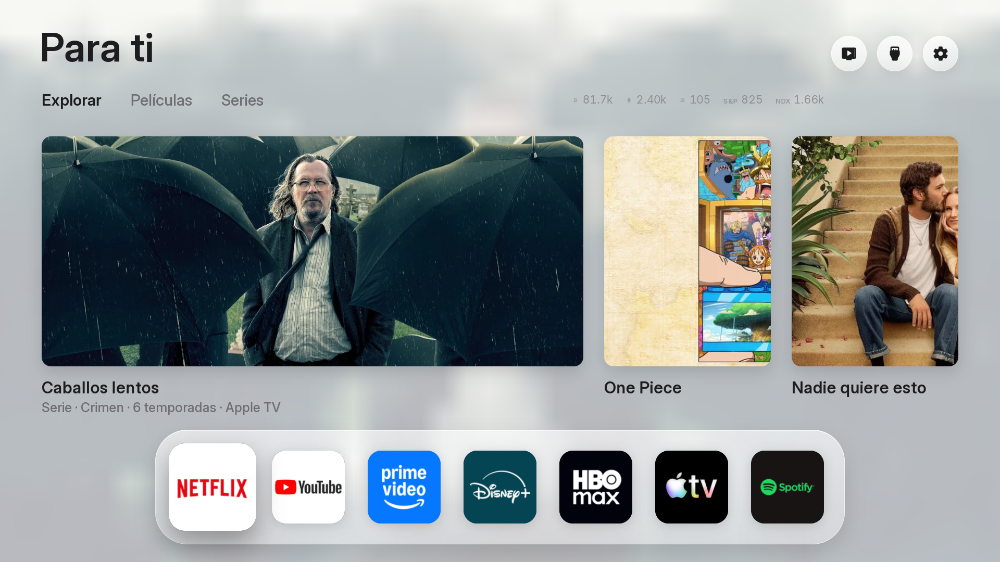

# FreeTV

**Una pantalla de inicio limpia, sin anuncios, para tu tele, y un botón Home que te lleva siempre a ella.**

**LG (webOS): probado** · Samsung (Tizen 2017+): experimental · Android TV y Google TV: app de Free My TV incluida · [qué hay para cada tele](docs/OTRAS-TELES.md)

[English version](README.en.md) · [Guía para hacerlo con cualquier IA](docs/GUIA-IA.md) · [Problemas y soluciones](docs/PROBLEMAS.md)



La pantalla de inicio de LG está llena de publicidad. FreeTV la deja de lado (no la borra) y pone la suya: tus apps como
iconos cuadrados de verdad, recomendaciones solo de los servicios donde tienes cuenta, el tiempo de tu ciudad y las
cotizaciones que te interesan. No hace falta rootear la tele: se instala como una app más con el **Modo Desarrollador**
de LG, y **todo se puede deshacer**.

## Qué hace

- **Iconos de app de verdad.** Los iconos que da la tele, cuadrados y a todo el cuadro, sin marcos. En el estante, **TV en
  directo** es un icono más (por defecto va donde iría Apple TV).
- **Mueve tus apps a tu gusto.** En el estante, mantén **OK** sobre un icono: se levanta; muévelo con ◀ ▶ y suéltalo con
  **OK**. El orden se guarda. Caben 12 en el estante; el resto está en *Todas las apps* (↓ y luego el botón de apps).
- **Sugerencias solo de tus cuentas.** Películas y series en tendencia de TMDB, solo de los servicios que activas en
  *Ajustes de inicio → Sugerencias* (por ejemplo, sin Disney+ ni Apple TV si no tienes cuenta). Ahí también eliges si
  quieres animación y anime, y cuántas sugerencias ver (6, 9, 12 o 18). Si cambias de cuenta, lo cambias ahí.
- **Explorar de verdad.** La fila de sugerencias se desliza hacia la derecha con ▶, y **cada tarjeta dice qué es y
  dónde verla** («Serie · Netflix», «Película · Prime Video»). La primera, más grande, trae género y duración.
- **Mercados en dólares:** Bitcoin, Ethereum, Solana y **XRP (Ripple)** (Binance), y el **S&P 500** y el **NASDAQ 100** de
  iShares (CSPX y CNDX, en dólares). Cada uno se puede apagar en Ajustes. Son datos informativos, no un consejo de inversión.
- **El tiempo** de tu ciudad, con amanecer y atardecer; la pantalla se oscurece de noche.
- **El botón Home de verdad.** Pulsas **Home** en cualquier app y vuelves a FreeTV, no al inicio de LG. Al salir de una
  app con **Atrás** también vuelves aquí: el ayudante espera algo más de un segundo a que LG se asiente y entonces abre
  FreeTV, una sola vez, sin ir y venir. Al encender la tele, el ayudante abre FreeTV (en algunas teles se ve el inicio de LG un par de segundos antes).
- **Renovación del Modo Desarrollador** (beta): el Modo Desarrollador de LG caduca a los ~40 días; en
  *Ajustes de inicio → Renovación del Modo Desarrollador* hay un panel para renovarlo desde la propia tele.
- **Salida de emergencia:** mantén **Home** 2 segundos y vuelves al inicio de LG; FreeTV deja de interceptar el botón.

## Qué necesitas

- Una **tele LG con webOS** (probada en una LG OLED). Si tu LG es antigua, mira [Problemas](docs/PROBLEMAS.md).
- Una **cuenta de desarrollador de LG gratis** (webostv.developer.lge.com), creada **con correo y contraseña** (si entras
  con Apple o Google, la tele no podrá iniciar sesión: usa «¿Olvidaste tu contraseña?» para ponerle una).
- Un **ordenador** en la misma red wifi que la tele, con **Linux, macOS o Windows con WSL**, y estas herramientas:
  `git`, `python3` (3.9 o más) y `node` (20 o más) con `npm`.
- Opcional: una **clave gratuita de TMDB** (themoviedb.org → Ajustes → API) para las recomendaciones y las fotos del
  salvapantallas. Es tuya y secreta.

> **Salvapantallas.** FreeTV trae uno propio con fotos de Sevilla, España y Lituania (licencias libres, con crédito del autor), sin root.
> Ver `docs/COMUNIDAD.md`.

## Instalación paso a paso

### 1. En la tele (lo haces tú)

1. Abre la **LG Content Store**, busca **Developer Mode** (Modo Desarrollador) e instálala.
2. Ábrela e inicia sesión con tu cuenta de desarrollador de LG.
3. Pon **Dev Mode Status** en **ON** (la tele se reinicia) y vuelve a abrir la app.
4. Activa **Key Server**. Verás la **IP** de la tele y una **passphrase** (seis caracteres). **La passphrase cambia cada vez
   que reinicias el Key Server y es privada: no la compartas ni la pegues en ningún chat.**

### 2. En el ordenador

Solo en **Windows**: instala WSL con Ubuntu (una vez) y trabaja **dentro de Ubuntu**, en tu carpeta personal (no en
`/mnt/c`):

```bash
wsl --install -d Ubuntu
```

Reinicia, abre *Ubuntu* y sigue ahí. En Linux, macOS y Ubuntu/WSL:

```bash
sudo apt update && sudo apt install -y git python3 python3-venv python3-pip curl xz-utils   # en macOS: brew install git python node
```

Node 20 o más (si `node --version` ya dice 20+, salta este paso):

```bash
curl -o- https://raw.githubusercontent.com/nvm-sh/nvm/v0.40.1/install.sh | bash
```

Cierra y abre la terminal, y:

```bash
nvm install 22
```

### 3. Descarga FreeTV y pon tus datos

```bash
git clone https://github.com/PharmaJava/FreeTV.git
cd FreeTV
cp config.example.properties config.properties
nano config.properties
```

Cambia al menos **la ciudad** (`city`, `latitude`, `longitude`) y `tmdb_region` (tu país). Si tienes clave de TMDB,
pégala tú en `tmdb_key=`. En `hide_services=` pon los servicios donde **no** tienes cuenta (por ejemplo `disney`).
Guarda con `Ctrl+O`, `Enter`, `Ctrl+X`. Este archivo no sale de tu ordenador (está en `.gitignore`).

### 4. Instala

```bash
bash install.sh 192.168.1.140
```

(con la IP de **tu** tele). El instalador construye la pantalla, descarga el ayudante del botón Home, lo prepara y lo
instala. Te pedirá la **passphrase**, que escribes tú, y la tele te enseñará un **aviso de emparejamiento** que aceptas
con el mando. Tarda unos minutos la primera vez.

Cuando acabe: abre cualquier app y pulsa **Home**, o apaga y enciende la tele.

## Cómo se usa

| Quieres… | Haz esto |
|---|---|
| Ir a FreeTV | Botón **Home** (o encender la tele) |
| Abrir una app | Selecciónala y **OK** |
| Mover un icono del estante | Mantén **OK** sobre él, ◀ ▶ para moverlo, **OK** para soltar |
| Elegir qué apps van en el estante | *Ajustes de inicio → Estante* |
| Ver más sugerencias | En el explorador, ▶ (se desliza); cada una dice su plataforma |
| Ver todas las apps | Baja con ▼ y abre *Todas las apps* |
| Elegir de qué servicios sugerir, animación y cuántas | *Ajustes de inicio → Sugerencias* |
| Quitar o poner las cotizaciones | *Ajustes de inicio* (Bitcoin, Ethereum, Solana, XRP, S&P 500, NASDAQ 100) |
| Renovar el Modo Desarrollador | *Ajustes de inicio → Renovación del Modo Desarrollador* (o **EXTEND** en la app Developer Mode) |
| Volver al inicio de LG | Mantén **Home** 2 segundos |
| Reactivar el botón Home tras esa pulsación larga | *Ajustes de inicio → Reactivar el botón Home* |

**Importante: el Modo Desarrollador de LG caduca a los unos 40 días.** Si caduca, la tele borra FreeTV (y el inicio de LG
vuelve a ser el de siempre). Pulsa **EXTEND** en la app *Developer Mode* de vez en cuando, o vuelve a ejecutar
`bash install.sh <IP>`: lo reinstala todo con tus ajustes.

## Actualizar o cambiar tus ajustes

Edita `config.properties` y vuelve a ejecutar `bash install.sh <IP>`. Para bajar novedades de FreeTV: `git pull` y lo mismo.

## Desinstalar

Desde la carpeta `FreeTV`:

```bash
cd work/helper
export PATH="$PWD/build/tools/node_modules/.bin:$PATH"
ares-install -d clean-your-tv-192-168-1-140 -r com.gathin.tvhome
ares-install -d clean-your-tv-192-168-1-140 -r com.local.nativehome
```

(sustituye `192-168-1-140` por tu IP con guiones). Con eso el botón Home y el inicio de LG vuelven a ser los de siempre.
Si algo va mal antes: **mantén Home 2 segundos**.

## Qué se instala en tu tele, y qué no

- Tres cosas dentro de la zona de apps del Modo Desarrollador: la pantalla **FreeTV** (`com.gathin.tvhome`), el servicio de
  renovación que va con ella y el ayudante **Home Helper** (`com.local.nativehome`), que escucha el botón Home.
- **No** se roota la tele, **no** se cambia el firmware, **no** se toca la imagen, el sonido ni la red, y **no** se borra
  nada de LG.
- Lo que sale de tu tele: peticiones a TMDB (recomendaciones), Open-Meteo (tiempo), Binance y Yahoo Finance
  (cotizaciones). Nada de tus datos se envía a ningún servidor de FreeTV: no hay.

## ¿No tienes Claude Code? Hazlo con cualquier IA

Lee [docs/GUIA-IA.md](docs/GUIA-IA.md): trae un texto para copiar y pegar en ChatGPT, Gemini, Claude, Copilot… que
te guía paso a paso y te dice qué copiar de la terminal cuando algo falla. Tú pulsas el mando y escribes tu passphrase;
la IA nunca la necesita.

## Tu clave de TMDB y GitHub

Tu `config.properties` (con tu clave de TMDB) **nunca** se sube: está en `.gitignore`. Además, el repositorio trae una
comprobación que **bloquea un commit** si va a publicar una clave o un archivo privado. Si piensas modificar FreeTV y subir
cambios, actívala una vez:

```bash
git config core.hooksPath .githooks
```

Y puedes revisar todo el historial cuando quieras con `python3 tools/check_secrets.py --all`.

## Apps de la comunidad (YouTube sin anuncios, Kodi, Jellyfin…)

*Ajustes de inicio → Apps de la comunidad* muestra el catálogo de webOS Homebrew, y `python3 tools/community.py install <id> <IP>`
instala **las que no necesitan root** (36 de 56), comprobando su hash antes. Hay un icono **Tienda** en el estante: **la propia tele
descarga e instala, sin ordenador** (si lo activas al instalar FreeTV; ver COMUNIDAD). Con `python3 tools/community.py serve <IP>` en el ordenador,
la propia pantalla de la tele las instala (botón **Instalar en esta tele**). YouTube sin anuncios, Kodi, Jellyfin, Moonlight,
Plex nativo, RetroArch, IPTV… Lo que pide root **no se instala**: FreeTV no hace root. Todo en [docs/COMUNIDAD.md](docs/COMUNIDAD.md).

## Otras teles

| Tele | Qué hay | Estado |
|---|---|---|
| **LG (webOS)** | FreeTV completo (esta guía) | **Probado** en una LG OLED |
| **Samsung (2017 o más)** | La misma pantalla, empaquetada en `tizen/`: [guía](docs/SAMSUNG.md) | **Experimental**: no probado por nosotros en Samsung |
| **Android TV / Google TV** | La app de Free My TV en `android/`: [guía](docs/ANDROID-TV.md) | Incluida sin cambios; no compilada ni probada aquí; sin las novedades de FreeTV |
| Samsung hasta 2016, Fire TV, Roku… | Nada | [Alternativa: un reproductor Google TV por HDMI](docs/OTRAS-TELES.md) |

¿Tienes una de estas teles? Cuéntanos cómo te fue en una [Issue](https://github.com/PharmaJava/FreeTV/issues).

## Probado y límites

- Probado en una **LG OLED** (webOS con Node 8.12 y Chrome 79). En esa tele se comprobaron el botón Home, la vuelta con
  **Atrás** (con el reintento), el reordenado, las cotizaciones y las recomendaciones. El arranque en frío depende de tu
  tele y de su firmware: si no abre FreeTV al encender, mira [Problemas](docs/PROBLEMAS.md).
- Otras LG (sobre todo modelos antiguos o muy nuevos) pueden comportarse distinto. El ayudante del botón Home es de otra
  persona y su autor lo probó en otras dos teles; FreeTV añade dos arreglos (ver [cómo funciona](docs/COMO-FUNCIONA.md)).
- Samsung y Android TV: ver la tabla de arriba; en esas teles no hemos probado FreeTV.
- La renovación automática del Modo Desarrollador es **beta** y sin confirmar en teles sin root: sigue mirando el
  contador y usa **EXTEND**.
- Al salir de una app con **Atrás** se ve el inicio de LG algo más de un segundo antes de que aparezca FreeTV; es lo que tarda
  LG en asentarse. Con menos espera, LG volvía a ponerse delante y se veía ir y venir.

## Créditos y licencias

FreeTV nace de [Free My TV](https://freemytv.io) (pantalla de inicio) y usa el ayudante de
[Razdva122/clean-your-tv-lg-webos](https://github.com/Razdva122/clean-your-tv-lg-webos) (botón Home y renovación). Todo
MIT. Detalle en [NOTICE.md](NOTICE.md). Este producto usa la API de TMDB pero no está avalado ni certificado por TMDB.
FreeTV no está afiliado a LG.
